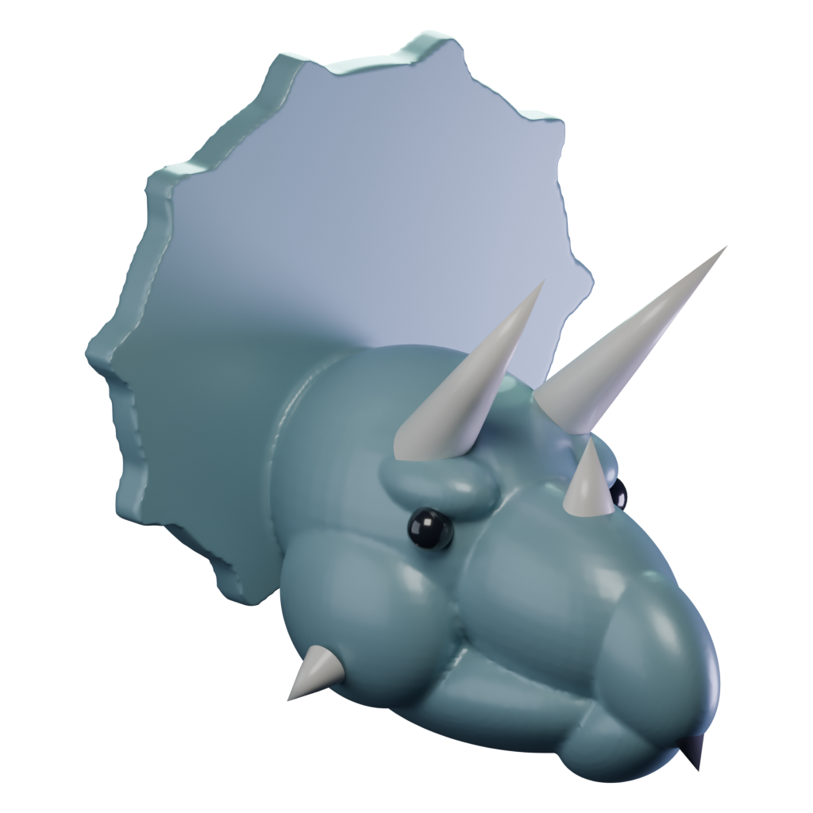
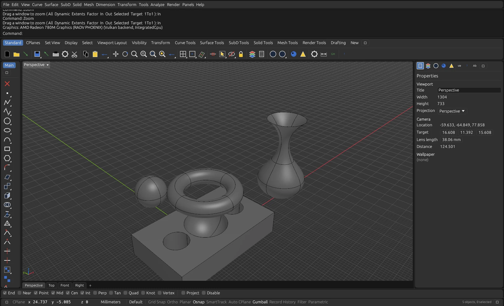
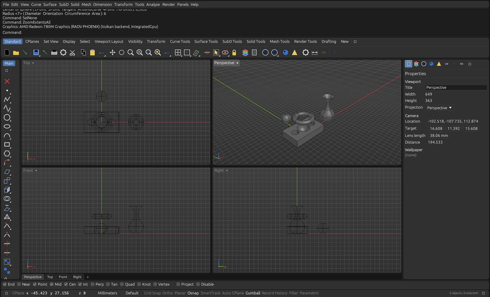
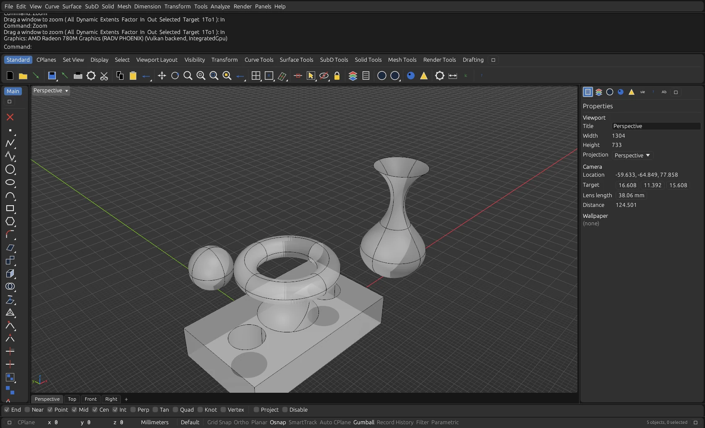
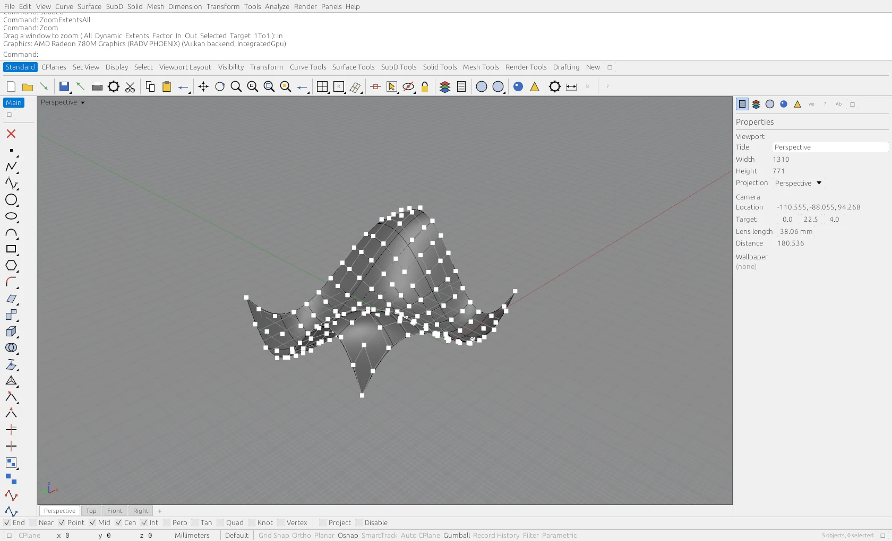
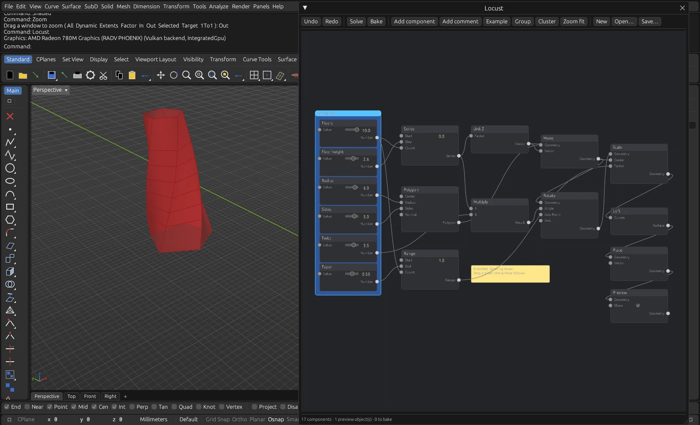

<div align="center">



# Triceratops

**Free, open-source NURBS 3D modelling, written in Rust.**<br>
Exact curves, surfaces and solids · native `.3dm` files · a node editor for algorithmic design.

[](https://github.com/libano23/triceratops-rs/actions/workflows/ci.yml)
[](https://github.com/libano23/triceratops-rs/releases/latest)
[](LICENSE)


[**Website**](https://libano23.github.io/triceratops-rs/) ·
[**Download**](#download) ·
[**Locust**](#locust-visual-programming) ·
[**AI assistants**](#model-with-an-ai-assistant-mcp) ·
[**Build from source**](#build-and-run)



</div>

## Features

Triceratops follows the interaction model of professional NURBS CAD tools: a command line with
prompts and clickable options, object snaps, four synchronised viewports, a gumball, layers, and
exact NURBS curves, surfaces and polysurfaces (B-reps).

- **Modelling:** points, curves (lines, polylines, arcs, circles, ellipses, interpolated and
  control-point curves), surfaces (extrude, revolve, loft, sweep, network, edge surfaces,
  patch, blend), solids, SubD-style meshes and meshes. About 1,070 commands are registered.
- **NURBS kernel:** exact surface/surface intersections, Booleans that keep the original
  surfaces and only add trim curves, projection of curves onto any surface, trimming and
  splitting by any number of curves.
- **Locust:** a built-in node editor for algorithmic modelling, with more than 200 components,
  Script and Expression nodes for modelling with code and formulas, and a live preview in the
  viewport ([below](#locust-visual-programming)).
- **AI assistants:** Claude, Codex and other MCP clients can model in the open window from a
  prompt, with commands or as a parametric Locust definition ([below](#model-with-an-ai-assistant-mcp)).
- **Long operations** (Booleans, Locust solves) run in the background: the window stays
  responsive, the status bar shows progress, and Esc cancels.
- **Interface:** dockable and floating panels and toolbars (including torn-off flyouts),
  light, dark and Blender-style themes, persistent settings and window layouts.
- **Display modes:** Wireframe, Shaded, Rendered, Ghosted, X-Ray, Technical, Arctic, Pen, and
  analysis modes such as Zebra, Curvature, Draft Angle and Thickness.
- **Files:** native `.3dm` through openNURBS, plus STEP, IGES, DXF/DWG, OBJ, STL, glTF and about
  twenty more formats.

<table>
  <tr>
    <td width="50%"><br><sub>The four-viewport workspace</sub></td>
    <td width="50%"><br><sub>Ghosted display shows the inside of Boolean cuts</sub></td>
  </tr>
  <tr>
    <td width="50%"><br><sub>A free-form surface with its control points, light theme</sub></td>
    <td width="50%"><br><sub>Locust drives a parametric tower</sub></td>
  </tr>
</table>

## Locust: visual programming

Locust is a node-based editor for algorithmic modelling, built into Triceratops. Type `Locust` in
the command line (or `lc`) to open it.

- **Components:** more than 200 of them, for numbers and maths, vectors and planes, curves,
  surfaces, solids, meshes, transforms, lists and data trees, text and analysis.
- **Live preview:** wire components together and drag a slider; the result is drawn in the
  viewport as you edit. **Bake** turns it into ordinary document objects.
- **Same kernel:** nodes call the NURBS kernel and the helpers the modelling commands use, so a
  lofted surface from Locust is the same surface the `Loft` command makes.
- **Organised graphs:** groups, comments, clusters (sub-graphs), undo and redo, copy and paste.
  The canvas is saved between sessions in `<config>/triceratops/locust.locust`, and definitions
  can be saved and opened as files.
- **Script and Expression:** an Expression node evaluates a formula of its inputs
  (`sin(x) * cos(y)`, radians); a Script node runs [Rhai](https://rhai.rs) code with its own
  inputs and outputs (item, list or tree access), with helpers for points, curves, surfaces,
  solids and transforms, and `run("Component", [...])` to call any component. Scripts are
  sandboxed (no files, processes or network) and an endless loop stops with an error.
- **Generative components:** Helix, Populate 2D and Populate Geometry (seeded random points),
  Voronoi (in a convex region) and Surface Voronoi (cells drawn on a surface).
- **Background solves:** the definition solves on another thread; moving a slider restarts it,
  the last result stays on screen meanwhile, Esc cancels, and each node shows its errors and
  warnings as a red or orange dot.

**Examples** (the editor's Examples menu): an M10 screw with its nut (male and female ISO
threads with clearance), an involute spur or helical gear, a surface from an equation, Voronoi
tiles and cells on a surface, and a dovetail joint with clearance. A starter example loads the
first time. The tower in the screenshot is [`site/tools/scenes/tower.locust`](site/tools/scenes/tower.locust):
open it from Locust's **Open...** button.

## Model with an AI assistant (MCP)

Claude, Codex and other [MCP](https://modelcontextprotocol.io) clients can model in the
Triceratops window you have open: you describe the part, the assistant runs Triceratops
commands, and the viewports update as it works. Everything it does is on the command history
and can be undone.

The executable doubles as the MCP server: `triceratops mcp` speaks MCP on stdin/stdout and
drives the running window over a local socket (it starts Triceratops if no window is open).

| System | Executable to use |
|--------|-------------------|
| Linux | the AppImage, e.g. `~/Applications/Triceratops.AppImage` (rename it so the path stays the same across versions) |
| Windows | `C:\path\to\Triceratops\triceratops.exe` |

```sh
# Claude Code
claude mcp add triceratops -- ~/Applications/Triceratops.AppImage mcp
# Codex
codex mcp add triceratops -- ~/Applications/Triceratops.AppImage mcp
```

Claude Desktop (`claude_desktop_config.json`) and Codex (`~/.codex/config.toml`):

```json
{ "mcpServers": { "triceratops": { "command": "C:\\path\\to\\Triceratops\\triceratops.exe", "args": ["mcp"] } } }
```

```toml
[mcp_servers.triceratops]
command = "/home/you/Applications/Triceratops.AppImage"
args = ["mcp"]
```

Then ask, for example: *"In Triceratops, make a 60×40×8 mm plate with two 6 mm holes 40 mm
apart and a 30 mm high flange along one long edge."*

The assistant models the way you ask: with **commands** (fixed geometry) or as a **Locust
definition**, a live parametric model you can keep adjusting with sliders. Ask for something
adjustable (*"a parametric M8 bolt and nut"*, *"a gear I can change the number of teeth of"*)
and it builds a definition in your Locust editor.

Tools: `run_commands` (command-line entries, exactly as typed), `get_state`, `list_objects`,
`object_info` (volume, area), `find_commands`, `capture_view` (an image of a viewport, so it
can look at its work), `undo`, `redo` and `cancel`; for Locust, `locust_components` (search the
catalogue), `locust_set_graph` (send a whole definition; the reply reports errors per node and
what it made), `locust_set_values` (move sliders, change a formula or a script by name),
`locust_solve`, `locust_get_graph` and `locust_bake`.

- Requests are refused while you are typing or running a command of your own; the
  assistant is told to try again. It can abandon a command it left waiting with `_Cancel`.
- A long operation (a big Boolean, a heavy Locust solve) answers when it ends and sends
  progress meanwhile; `cancel` stops it, and so does Esc in the window.
- Commands that would open a dialog do not: Loft uses its default options, and commands that
  need a file (Open, Save, Import, Export) are refused.
- Only programs running as you on the same computer can connect; nothing listens on the
  network. **Options > AI Assistants** switches it off, and the status bar shows
  *Assistant connected* while an assistant is attached.

## Download

Ready-to-run builds are attached to each [GitHub release](https://github.com/libano23/triceratops-rs/releases/latest),
and the [website](https://libano23.github.io/triceratops-rs/#download) links the right one for your system:

| Platform | File | How to start |
|----------|------|--------------|
| Linux (x86_64, glibc 2.35+) | `Triceratops-<version>-x86_64.AppImage` | `chmod +x Triceratops-*.AppImage`, then run it |
| Windows 10/11 (x64) | `Triceratops-<version>-windows-x64.zip` | Unzip and run `triceratops.exe` |

macOS builds were published up to 0.3.0 and are no longer made.

## Build and run

Requirements: a recent stable Rust toolchain, CMake and a C++ compiler (for the vendored
openNURBS), and a GPU driver with Vulkan or OpenGL ES support.

```sh
cargo run --release                    # start Triceratops
cargo run --release -- model.3dm       # open a file
cargo run --release -- --script s.txt  # run command lines from a file at start-up
cargo test --workspace                 # run the test suites
```

`./triceratops.sh` does the same as `cargo run --release`: it rebuilds when the sources changed,
then starts the program with any arguments you pass (`./triceratops.sh model.3dm`,
`./triceratops.sh --script s.txt`). Pass `--no-build` first to skip the build check.

The first build compiles openNURBS and takes a few minutes. On Windows, install the Visual
Studio Build Tools (C++ workload) and CMake. Triceratops is developed on Arch Linux under
Wayland with an AMD GPU; the Windows build is compiled and tested in CI. macOS is not supported.

## Packaging

Each script runs on its own OS and writes to `dist/`:

| Platform | Command | Output |
|----------|---------|--------|
| Linux | `scripts/package-linux.sh` | `Triceratops-<version>-x86_64.AppImage` |
| Windows | `pwsh scripts/package-windows.ps1` | `Triceratops-<version>-windows-x64.zip` |

The [Build workflow](.github/workflows/release.yml) runs both on GitHub-hosted runners.
Start it from the Actions tab, or push a version tag to publish a release:

```sh
git tag v0.2.0 && git push origin v0.2.0
```

Bump `version` in the root `Cargo.toml` first; the tag and the version should match. In
[CHANGELOG.md](CHANGELOG.md), rename the "Unreleased" section to the version and date: it
becomes the release notes (`scripts/changelog_section.py` extracts it, and the release
fails without it) and is what Triceratops shows users when it offers the update. The full
checklist, including how to test the update path, is in [docs/RELEASING.md](docs/RELEASING.md).

## Using it

Type a command name in the command line (`Box`, `Loft`, `BooleanDifference`, `WireCut`, ...)
or click a toolbar button. Prompts show their options in parentheses; click an option or type
its name. Enter repeats the last command. Middle-click in a viewport opens the popup toolbar.

- **Panels and toolbars:** drag a tab out of its container to float it, or use the `▾` menu to
  dock it on any side. Flyouts, such as Array or Scale, can be torn off with their `⇱` button
  or by dragging their title.
- **Settings:** osnaps, Ortho, Grid Snap, Planar, Gumball, the window layout, the theme and the
  export folders are saved automatically. Options > Appearance can save or load a layout file
  and reset everything to the defaults.
- **Themes:** `Theme` or View > Theme switches between Triceratops Light, Triceratops Dark and
  Blender. User themes are JSON files.
- **Scripts:** a script file contains one command-line entry per line. An empty line presses
  Enter. Objects are referenced as `#12`, `#12@x,y,z` (a pick at a point) or `last`.

## File formats

| Kind | Read and write | Write only |
|------|----------------|------------|
| Native | 3DM (openNURBS), TRI (JSON) | |
| CAD | STEP (AP214 B-rep), IGES (trimmed surfaces), VDA-FS, DXF, DWG | |
| Meshes | OBJ, STL, PLY, OFF, 3DS, glTF/GLB, DAE, WRL, X3D, X, AMF, 3MF, GTS, RAW, FBX (ASCII), SLC | POV-Ray, RIB |
| 2D | SVG | PDF, EPS, AI |
| Points | PTS, XYZ, ASC, CSV, TXT | |

Export proposes the working file's folder and name, remembers the last folder and file type,
and always uses the extension of the file type chosen in the dialog. Proprietary formats that
cannot be read (SKP, SAT, DGN, E57, binary FBX, ...) give a message naming an alternative.

## Configuration

| Path or variable | Purpose |
|------------------|---------|
| `<config>/triceratops/options.json` | Settings, window layout, export memory |
| `<config>/triceratops/themes/*.json` | User themes |
| `TRICERATOPS_BACKEND=auto\|gl\|vulkan` | Graphics backend |
| `TRICERATOPS_BOOL_DEBUG=1` | Diagnostics for Booleans, projections and trims |

`<config>` is `~/.config` on Linux and `%APPDATA%` on Windows.

## Project layout

| Crate | Contents |
|-------|----------|
| `crates/geom` (`tri-geom`) | NURBS kernel: curves, surfaces, trimmed faces and B-reps, meshes, exact Booleans (`brep_boolean_exact.rs`), surface projection and region splitting (`surface_ops.rs`) |
| `crates/doc` (`tri-doc`) | Document model, layers, undo, history, the native format, and the import/export registry in `formats/` |
| `crates/app` (`triceratops`) | The application: wgpu renderer, egui interface, docking, themes, the command system and every command |
| `crates/on3dm` | Rust bindings to the vendored openNURBS library for `.3dm` files |

`docs/FEATURES.md` describes the implemented features command by command.
`docs/ui-reference.md` and `docs/toolbars-reference.txt` record the interaction conventions
being followed. `docs/commands.json` is the command catalogue.

## Tests

`cargo test --workspace` runs:

- geometry tests, including Booleans checked for closure, volume and edge accuracy;
- format round trips for every reader and writer;
- command-flow tests that drive commands through their prompts as a user would;
- the openNURBS round trip.

## Limitations

- Trim curves from Booleans and projections are polylines in the surface parameter space,
  refined to the model tolerance; they are not analytic curves.
- Shell works on solids with planar faces only.
- FilletEdge works on planar faces only.
- SubD objects are smoothed meshes.
- Digitizer support, licensing and plug-in management are not available.
  Those commands say so and name the closest alternative.

## Contributing

Bug reports and pull requests are welcome. Before opening a pull request, run
`cargo clippy --workspace --all-targets -- -D warnings` and `cargo test --workspace`; CI runs
both on Linux and Windows.

## License

Triceratops is released under the MIT license. openNURBS, in `third_party/opennurbs`, is
distributed under its own license (see `third_party/opennurbs/LICENSE`).
